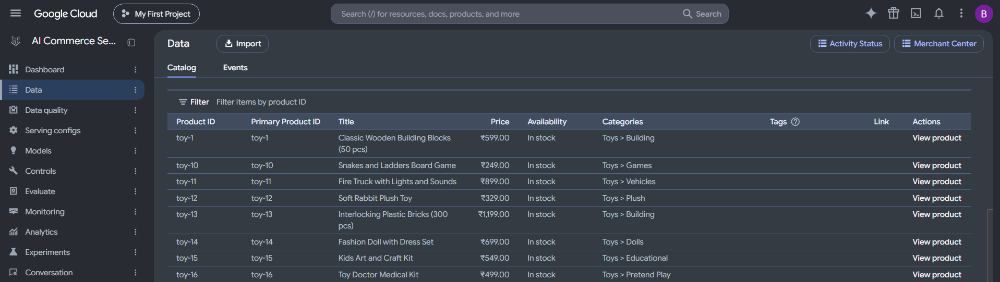
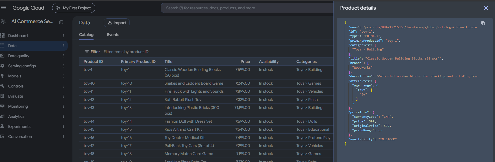
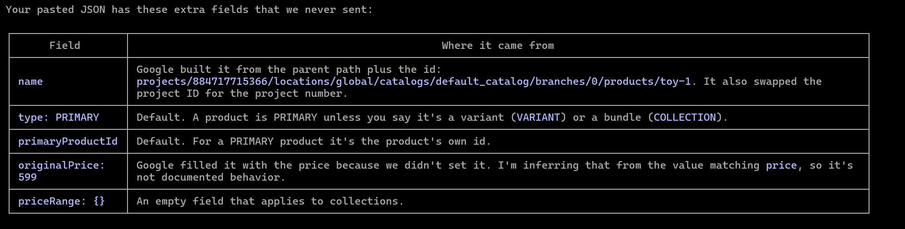

# AI Commerce Search (Retail API) - FAQ and Working Understanding

This file records what we understand about the service, in question-and-answer form, so a new reader can get the idea quickly. It is a plain-language summary, not official documentation. Anything about internals is inferred, because Google does not publish how the service works inside. Pricing details are from memory and must be checked against Google's pricing page before relying on them.

For the full build record of this module (what was built, results, quirks), see `package-info.java` in this folder.

## What is this service?

A managed product-search engine from Google Cloud. You give it a product catalog, and it gives you ranked search results, filters and facets, and recommendations. You do not run any servers or databases for it.

## What is it called? Why are there several names?

It has been renamed several times: Vertex AI Search for Retail, then Vertex AI Search for Commerce, and the Console currently shows "AI Commerce Search" (as of 2026-08-31). The API name never changed: `retail.googleapis.com`. So "Retail API", "Search for Commerce" and "AI Commerce Search" all mean the same product. The Console page is reached by searching for "retail" in the Console search bar.

## Is this the same as module 08 (Gemini / generative AI)?

No. Module 08 (`_08_genai`) is a general-purpose LLM platform. You send prompts to Gemini and build your own retrieval and agents. This module is a separate, purpose-built product with a different API (`retail.googleapis.com` instead of `aiplatform.googleapis.com`). Both sit loosely under Google's "Vertex AI" family branding, but they are different services. Module 08 is generative AI only. Module 09 is the real search product.

## Is it a database?

Not in the sense of a system of record. It is a search index, a read-optimized copy of your catalog built for fast and relevant search. It can filter and facet (price, brand, category), but it is not meant to hold orders, stock levels or authoritative prices.

## Is it like Elasticsearch?

Partly. It does keyword search, filters and facets in a way similar to Elasticsearch. On top of that it adds a semantic layer, so a query like "warm winter jacket" can match a product titled "insulated parka" without shared words. The effect is similar to a vector database, but you never see or manage the vectors.

## How does it work internally?

Google does not document this, so this is an inference. It most likely combines three layers:

1. Keyword matching, so exact words and filters work.
2. Embedding-based semantic retrieval, so meaning is matched as well as words.
3. A learned ranking model on top, which reorders results using user behavior such as clicks, add-to-cart and purchases.

It also does query understanding (spelling, synonyms, intent) and supports business rules such as boosting, burying and filtering.

## Is it an LLM that calls a vector database to save tokens?

No. No LLM tokens are involved and you are not billed per token. That pattern (an LLM plus a retrieval step) is what module 08's `SimpleRagDemo` builds by hand. This service is a ready-made search engine, not an LLM agent.

## How do I get data into it?

You upload your catalog as product records in JSON form. There are two ways:

1. Bulk import, from Cloud Storage, BigQuery, or inline in the request.
2. Incremental changes, creating, updating or deleting single products through the API.

In this repo the 703-product test catalog was generated in memory by `ProductCatalogGenerator` and streamed straight into the import call. `CatalogExportDemo` dumps the same data to `search-experiments/catalog-export.json` for inspection.

## How do I talk to it?

Through API calls (REST or gRPC, with Java client libraries). The main resources are:

- Catalog and Product: create, get, update, delete, import and purge products.
- UserEvent: send behavior events back to the service.
- Search: send a query and receive ranked products with facets.
- Serving configs and controls: choose and tune how search behaves, for example boost or pin rules.
- Models: used for recommendations.

## Can I use it as my main product database?

No. Treat it as a derived read model. Your own database (Postgres, Spanner and so on) holds the truth: price, stock, descriptions. A sync step keeps the search index current. Writes to the index are eventually consistent, so a change may take a short while to appear in search results.

A practical rule: use search to find product IDs, then read the live price and stock from your own database. Never use a search result to decide the price at checkout.

## Is the setup the same as server, schema, database, table, document?

Not really. There is no server to create and no schema to define up front. The mapping is:

- Enable the API (`retail.googleapis.com`) on the project. This replaces creating a server. Google runs everything.
- Catalog: one per project and location, already present as `default_catalog`. Roughly the database. You do not create it.
- Branch: independent slots `0`, `1` and `2` inside the catalog. Roughly the table. Our import wrote to `default_catalog/branches/0`.
- Product: one record with an ID, title, description, categories, price, brand and so on. This is the document.
- Serving config: the search settings object that queries run through (`default_search` in our test). It has no database equivalent. It holds ranking, boost and filter rules and exists by default.

Other differences from a normal database:

- The Product has a fixed set of standard fields. Extra fields such as size or weight go in a free-form `attributes` map, so no columns are declared first.
- There is no `CREATE INDEX`. Indexing is automatic after import, with a lag before search sees changes.
- Everything goes through the API. There is no SQL and no driver.
- To clear the data, purge the branch (`CatalogPurgeDemo`).

## How many catalogs can one project have?

One live catalog per project. The only catalog is `default_catalog` and a second one cannot be created. This is from memory of the API and has not been re-checked against Google's docs.

Related points:

- Branches `0`, `1` and `2` are three independent slots that can each hold a product list, not three catalogs and not automatic copies. Only one is live (the default branch) at a time. The usual use is to load a new version into an idle branch and then switch to it, so a reload causes no downtime.
- Catalogs are tied to a location. This project uses `global`. Regional options may exist, and how they affect the one-catalog rule is unverified.
- A catalog can have many serving configs, for example one for web and one for mobile, or one with different boost rules. They all search the same products.

## How is data organised inside the catalog? What are branches?

Under the one `default_catalog` there are two separate stores:

1. The product store (also called the catalog store). This holds the product list. It has three branches, numbered 0, 1 and 2.
2. The user event store. This holds shopper behavior (searches, clicks, add-to-cart, purchases). It has no branches. All events go into one stream for the catalog, and each event refers to products by ID only.

A branch is an independent slot that can hold a full product list. It is not a node, a shard or a replica. It does not hold part of the data, and nothing is copied between branches automatically. Branches 1 and 2 stay empty until you import something into them. Replication and backup exist inside Google's storage, but they are invisible to you and have nothing to do with branches.

The branch is chosen by the path in each call. Examples, with the project and location parts shortened:

- `.../catalogs/default_catalog/branches/0` is the parent path for importing, creating or purging products in branch 0.
- `.../catalogs/default_catalog/branches/1` is the same for branch 1.
- `.../catalogs/default_catalog/branches/0/products/toy-2` is the full name of one product. Get, update and delete calls use this name.

CRUD operations on products, all through the Product API:

- Create one product: `createProduct`, with the branch as parent and a product ID.
- Bulk create or replace: `importProducts`, with the branch as parent. Inline batches are limited to 100 products per request.
- Read one: `getProduct`, with the full product name.
- Read many: `listProducts`, with the branch as parent.
- Update: `updateProduct`, with the product name and a field mask naming which fields change.
- Delete one: `deleteProduct`, with the full product name.
- Delete many: `purgeProducts`, with the branch as parent and a filter (`*` means everything).

Search is different. A search call goes to the serving config (`.../servingConfigs/default_search`) and has no branch in its path. It reads from whichever branch is the current default branch, so the path selects the branch for writes and direct reads, and the default-branch setting selects it for search.

Typical use of three branches: serve search from branch 0, load a new version of the catalog into branch 1, check it, then make branch 1 the default. If something is wrong, switch back. This is similar to blue/green deployment. The switching steps have not yet been tried in this project.

Because events are not per branch, switching branches does not reset what the service has learned from events. The old events only help if the new branch uses the same product IDs.

## What if I have several companies or stores?

Two options:

1. One catalog, with a tag on each product (for example a `company` attribute) and a filter at query time. This suits several stores or brands inside one business, where products, customers and billing are shared.
2. One GCP project per company, each with its own catalog. This suits unrelated businesses.

Example: two separate retail companies, Company A (a fashion retailer) and Company B (an electronics retailer).

- Put Company A's catalog in project `company-a-search` and Company B's catalog in project `company-b-search`. Each project has its own `default_catalog`.
- It is technically possible to load both into one project and filter by a `company` attribute. It is a bad idea here, for these reasons:
  - Billing: search is billed per request, and one project gives one bill, so costs cannot be split cleanly.
  - Access: IAM permissions apply to the project, so Company A's engineers would be able to reach Company B's data.
  - Learning: user events from both companies would feed the same ranking models, mixing signals from different shoppers and products.
  - Data quality: different categories, attributes and currencies end up in one catalog.
  - Risk: a bad import or purge in one company's branch can affect the other.
- Separate projects cost a little extra setup (enable the API, set permissions and billing per project) and give clean isolation.

Rule of thumb: tags and filters inside one catalog for one business, one project per unrelated business.

## What did we send, and what does the service store?

We build each toy in `ToyCatalog.java` and send these fields:

- `id`, `title`, `description`
- `categories` (a list, for example `Toys > Building`) and `brands` (a list)
- `priceInfo` (`currencyCode` INR and `price`)
- `availability` (IN_STOCK)
- `attributes` with one custom key, `age_range`

When we read the product back (`getProduct`, or the Console), it has extra fields we never sent:

- `name`: the full path, built by Google from the parent path plus the id. The project ID in the path is replaced by the project number.
- `type`: PRIMARY. This is the default. The other values are VARIANT and COLLECTION.
- `primaryProductId`: the default, which is the product's own id.
- `originalPrice`: filled with the same value as `price` because we did not set it (inferred from the matching value, not documented).
- `priceRange`: empty, only used by collections.

This works because the Product is a protobuf message whose definition belongs to Google. Missing fields get defaults and derived fields such as `name` are computed on the server, similar to column defaults and generated keys in a SQL database.

The Console product list shows only a fixed set of columns (ID, title, price, availability, categories, tags, link). Custom attributes such as `age_range` are stored but not shown there. Use `getProduct` to see the full record.

## Is the product schema fixed or free-form?

Both, and the split is clear:

- The top-level field names are fixed by Google. We cannot add our own field at the root, such as `color_of_toy` next to `title`. An unknown field name or a wrong type (for example a text price) is rejected. We never define this schema and cannot change it.
- Arrays such as `categories` and `brands` take many items, but only values of their own type (strings). They do not allow new field names.
- `attributes` is the one free area. It is a map: each key is a name we choose (`age_range`, `material`, `battery`) and each value is a small typed object holding either text values or number values. Keys can differ per product and can be added at any time with an update, with no migration.

So any data that does not fit a standard field goes in `attributes`. Storing an attribute is free. Using it to filter or facet probably needs indexing to be switched on for that attribute in the catalog attribute settings (from memory, not yet tested).

Most fields are optional per product. As far as we know `id`, `title` and `categories` are the ones needed for a PRIMARY product (not yet tested).

## What are the standard Product fields?

- Identity: `name` (generated), `id`, `type`, `primaryProductId`, `collectionMemberIds`, `gtin`.
- Content: `title`, `description`, `categories`, `brands`, `languageCode`, `tags`, `materials`, `patterns`, `sizes`, `conditions`, `colorInfo`, `audience`.
- Commerce: `priceInfo` (currency, price, original price, cost), `availability`, `availableQuantity`, `availableTime`, `fulfillmentInfo`, `localInventories`, `promotions`, `rating`.
- Display and lifecycle: `uri`, `images`, `publishTime`, `expireTime` or `ttl`, `variants` (read-only), `retrievableFields`.
- Your own fields: `attributes`.

Fields we leave out are signals the ranker cannot use. Price and availability matter for filters and for hiding out-of-stock items. Description, brands and tags feed matching. Images and `uri` matter when results are shown to shoppers.

- ``what we pushed`` 
```

  id            = "toy-1"
  title         = "Classic Wooden Building Blocks (50 pcs)"
  description   = "Colourful wooden blocks..."
  categories    = ["Toys > Building"]
  brands        = ["WoodWorks"]
  priceInfo     = { currencyCode: INR, price: 599 }
  availability  = IN_STOCK
  attributes    = { age_range: { text: ["3+"] } }
```

- ``GCP side``




## What is the official Product template?

Google's REST reference for the Product resource (`projects.locations.catalogs.branches.products`) defines the shape every product must follow. Root keys are Google's list only. The free area is `attributes`, where each value has a fixed shape of its own:

- `text`: a list of strings
- `numbers`: a list of numbers
- `searchable`: boolean
- `indexable`: boolean

The two booleans mean the behavior can be set per product at upload time, in the JSON itself. The same behavior can also be set site-wide on the Controls page in the Console (see below). Our toys send only `text`, so the flags take their defaults. Which one wins when the two disagree has not been tested.

`expireTime` and `ttl` are a one-of: send one, not both. `name` and `variants` are filled in by Google.

## What are the items in the Console left menu?

The AI Commerce Search menu shows: Dashboard, Data, Data quality, Serving configs, Models, Controls, Evaluate, Monitoring, Analytics, Experiments, Conversation. Seen so far: Data (the Catalog tab shows branches 0 to 2 with product counts, the Events tab shows user event statistics), Controls, Data quality and Monitoring. The others have not been opened.

The Console page for our project is reached with the project ID in the URL, for example `.../ai/retail/catalogs/default_catalog/data/catalog?project=<project-id>`. Several projects can share the display name "My First Project", so always pick a project by its ID, not its name.

Open item: the Console once showed the message `Failed to get full branch details: db'undefined'` while the product list loaded correctly. It looks like a Console frontend bug. The cause was not investigated.

## What is the Attribute Controls page?

In the Console, Controls has tabs: Serving Controls (empty for us), Attribute Controls, Autocomplete Controls, Facet/Tile Controls and Merchant Console. The Attribute Controls tab lists 37 rows. Here "attribute" means any key the engine knows about in the product JSON: Google's standard keys (`brands`, `categories`, `availability`, `colors`, `ageGroups`, `cost` and so on) plus our custom key, shown as `attributes.age_range`. Google created that row automatically after our upload.

Each row has switches that say what the engine may do with that key:

- Indexable: the engine builds a lookup structure for the key, so it can be used in filters, facets and boost rules. If it is off, the value is stored but not usable for those (the exact failure was not tested). This is about capability, not speed.
- Searchable: typed query text is matched against the value. `brands`, `categories` and `colors` are on. `attributes.age_range` is off for us, so the query "3+" would not match toys by age, although a filter on `age_range` should still work.
- Retrievable: the value is returned inside each search result (from memory, not tested). All rows we looked at are off.
- Dynamic Faceting and Tiling: the engine can build facets from the key automatically.
- Exact Match: the query must match the value exactly (from memory).
- Filterable: according to the Console text, it only affects filter-tag generation for recommendations.

Timing, from the Console text: changes to indexable, searchable and retrievable apply at the next catalog import or within 12 hours or more. Changes to faceting and exact match take up to 2 days. So after changing a switch, re-import and then test.

Two layers to remember: the key exists because we uploaded it, and the engine uses it only as far as these switches allow. A key with every switch off is stored and does nothing.

## What is a facet?

A facet is a group-by with counts, computed over the search results and not over the whole catalog. It is the filter sidebar on a shopping site:

```
Age:    3+ (8)    0+ (2)
Brand:  WoodWorks (5)   SpeedToys (5)
```

In SQL terms it is `SELECT age_range, COUNT(*) FROM toys WHERE <matches the query> GROUP BY age_range`. The counts change with each query, and they come back in the same search response as the ranked products. Clicking a facet value sends a new search with a filter added, which is like adding `WHERE age_range = '3+'`. Elasticsearch calls the same idea aggregations. A key needs Indexable and Dynamic Faceting on to appear as a facet.

## What is a boost rule?

A boost rule is a manual instruction that changes ranking for some products. Examples: raise products of one brand, push down out-of-stock items, pin a product at the top for a given query. Rules are created under Serving Controls (empty for us) and use a filter on an attribute to pick the products, so that attribute must be indexable.

Learning to rank changes ranking automatically from user events. A boost rule is the human override. Neither is tested yet.

## How does a search or event flow from the UI to the service? (toy store)

Code is in the `toystore` package. The flow is UI, then our backend, then the Retail API.

Step 1: the UI calls our backend (`index.html`).

- Search is a GET with no body, for example `GET /api/toys/search?q=toy&visitorId=user1`. The backend answers with JSON: `query`, `attributionToken`, and `results` (each with `id`, `title`, `price`, `brand`, `category`). The page keeps the attribution token in a variable.
- Every shopper action is a `POST /api/events` with a JSON body: `eventType`, `visitorId`, `attributionToken`, `productId` and `searchQuery`. For a search event `productId` is null and `searchQuery` is set. Valid event types are `search`, `detail-page-view`, `add-to-cart` and `purchase-complete`. Anything else returns HTTP 400.

Step 2: the backend calls the Retail API (`ToyRetailGateway`, the only class that talks to it).

- Search builds a `SearchRequest` with `placement` (the `default_search` serving config), `branch` (branch 0), `query`, `visitorId` and `pageSize` 20. The response has ranked product ids and an `attributionToken`. The backend then reads title and price from our own `ToyCatalog`, which stands in for the real database. The index finds, our own data displays.
- An event builds a `UserEvent` and calls `writeUserEvent` on the catalog path. It carries `eventType`, `visitorId`, `eventTime` (now) and the `attributionToken`. View, cart and buy events add `productDetails` (product id and quantity 1). A purchase also adds `purchaseTransaction` (revenue is the toy price, currency INR). A search event adds `searchQuery`.
- Authentication is Application Default Credentials, as in `ToyAuthDemo`.

Step 3: what the user event store holds.

- One record per action, with event type, visitor id, time, attribution token, product ids by reference (no product data), and for purchases the revenue and currency.
- There are no user profiles. The "user" is only the `visitorId` string we choose, so `user1` to `user5` need no sign-up.
- The API has no call to list or count events. The Console Events tab shows only aggregate statistics (event type, events ingested, share of unjoined events, days with joined events). Right after our first test event it showed "No user events statistics could be found", with a date range ending the day before. Whether this is a reporting lag was not verified.

Simulator: `ToyUserSimulator` runs five fake shoppers who mostly click toy-2. `rank` prints the current ranking and sends nothing. `events N` sends N sessions of events. Baseline before any events: for the query "toy", toy-2 was at position 8 (only 10 of the 20 toys were returned, reason not investigated).

## What are user events and why do they matter?

User events are records you send back to the service about what shoppers did: a search, viewing a product detail page, adding to cart, completing a purchase. They are how the service learns. Without them the ranker has nothing to learn from.

Our earlier module 09 tests (before the toy store) sent no user events. That is the most likely reason AI Commerce Search scored 2.83 out of 10 on natural-language queries, against 7.17 for untuned Elasticsearch. This is a hypothesis, not yet verified by experiment.

## How does learning from behavior work?

Suppose a search shows 10 products and most users click product 7. If those clicks are sent back as events, the ranking model can learn to move product 7 higher for similar queries.

Details worth knowing:

- This is learning to rank from logged behavior. It is not reinforcement learning in the strict sense, where an agent tries actions and gets rewards. Google does not document that part, so "learns from events" is the safe description.
- It works on patterns, so it needs enough traffic. A few users will not change anything noticeable.
- A click on a low position is stronger evidence than a click on position 1, because people click top results anyway. Good rankers correct for this position bias.
- A purchase is a much stronger signal than a click.
- The learning is automatic. To force a specific product to the top by hand, use serving-config controls (boost or pin rules) instead.

## User events: where they are stored and what we tested

Where they are stored: in the user event store of the catalog, a separate store from the product store. It has no branches. Every event goes into one stream per catalog and refers to products by id only, so it holds no product data. The "user" is just the `visitorId` string we send.

The flow we built, in one line: the shopper clicks a button in the UI, the UI calls our backend, the backend calls `writeUserEvent` on the Retail API, and Vertex stores the event. The steps run in a line, not in parallel. A real shop would often send events in the background so a slow call cannot delay the page. The steps are described in the section above.

What we did:

- Used the UI (`http://localhost:8080/`) as five shoppers, `user1` to `user5`, and clicked view, add to cart and buy.
- Ran `ToyUserSimulator events 200`. It ran 200 sessions: 200 views, 101 add-to-carts and 47 purchases, with toy-2 as the favourite.
- Our own history file `search-experiments/toy-events.tsv` ended at 583 events. For toy-2 it holds 144 views, 73 add-to-carts and 34 purchases. The next toy, toy-5, has 28 views.

What we saw in the Vertex Console:

- Monitoring (1 day) shows a spike in `UserEventService.WriteUserEvent` traffic at the time of the simulation, and 0 errors, including 0 unjoined events. This is the proof that Vertex received the events.
- The Data, Events tab and the Data quality page showed no event statistics. The Data quality checks were last run on October 7, 2026. Why the Events tab stays empty was not found.
- The Console has no per-shopper event viewer. Shopper history can only be read from our own file.

Result: the ranking of the query "toy" did not change (toy-2 stayed at position 8 before and after). This is expected, because we are far below the volume the service asks for (next section).

Lessons:

- Keep your own copy of events. The service cannot list them back.
- The attribution token from a search must go with the events that come from that search. A UI bug let one shopper reuse the previous shopper's token, which was fixed by clearing the token when the shopper changes.
- The shopper id on an event should match the one used in the search request.
- Our search events do not yet include the list of products shown (product impressions), which the Data quality page checks for.

## How much event data does the ranking model need? (read from the Console)

The Console page Data quality (Text Search tab) lists the data the service expects before each model tier can train. These are the numbers shown on that page for our project:

- Tier 1, Relevance: no event volume needed. It checks catalog quality (titles, descriptions, number of custom searchable attributes) and the ratio of detail-page-view events to search events.
- Tier 2, Relevance and popularity (this is where clicks start to influence ranking): 100,000 text search and browse events in the last 90 days, and 10,000 detail-page-view, add-to-cart and purchase events. Other checks here: events joined with products (95%), search events with attribution tokens (95%) and search events with product impressions (95%).
- Tier 3, Revenue optimized: 200,000 search events, 250,000 detail-page-views attributable to a search, products with at least one detail-page-view (100), and prices on 95% of products.
- Tier 4, Personalized revenue optimized: 100,000 search events served by the service, plus user IDs on events and requests.

So the 5-shopper simulation proves the pipeline (UI, backend, events accepted) but cannot be expected to change ranking. We are orders of magnitude below the Tier 2 numbers.

Other things seen on that page:

- The checks on it say they were last run on October 7, 2026, so the values are stale and do not reflect today's catalog or events. For example it shows 0% of products with titles, which is wrong for the current toy catalog.
- A search event with product impressions means the event lists the products that were shown. Our search events currently send only the query and token, with no product list.

The Events tab (Data, Events) showed no statistics for our events, under both Real time and 90 days. The Console has no per-shopper event viewer that we found. Our own history file (`search-experiments/toy-events.tsv`) is where shopper history can be read.

## What does each tier do, in simple words?

Think of each tier as one feature that switches on once you have enough data. Each tier below has an Amazon example first, then the same idea for our toy store. The "Seller says" lines are the pitch a seller would make to the owner of a toy store. The effect of each tier is my reading of the tier names, so treat it as the idea, not an exact Google description.

**Tier 1: Basic relevance.**
- What it does: matches the search words to your product titles and descriptions. No shopper data is used.
- What it needs: good product data, meaning titles and descriptions. We have that.
- Amazon example: you search "phone" and you get things with "phone" in the name.

**Tier 1 for the toy store: "Find the right toy."**
- Seller says: "A customer types 'teddy'. We show the teddy bear first, not a toy car. You don't need any customer data. Just give us good toy names and descriptions."
- Toy example: search "teddy" returns toy-2. This already works for us today.

**Tier 2: Popularity. This is where clicks start to matter.**
- What it does: products that people click more move up.
- What it needs: 100,000 search events in the last 90 days, and 10,000 clicks, add-to-carts and purchases combined.
- Amazon example: most people search "phone" and click one model, so that model rises to the top.

**Tier 2 for the toy store: "Show the toys people love."**
- Seller says: "Say 1,000 customers search 'toy' and most of them click the teddy. We move the teddy to the top, so the next customer finds it fast and buys more."
- Needs: 100,000 searches and 10,000 clicks, add-to-carts and purchases in 90 days.
- Toy example: this is what we tried to trigger with toy-2. We sent clicks, but the volume is too low, so toy-2 stayed at position 8.

**Tier 3: Revenue.**
- What it does: products that earn more money rank higher.
- What it needs: 200,000 search events, plus prices on 95% of products.
- Amazon example: two similar phones, and the one that sells more shows first.

**Tier 3 for the toy store: "Show the toys that make you money."**
- Seller says: "Two toys get the same clicks. One costs 500 rupees and sells a lot. The other is cheap and rarely sold. We put the one that earns you more in front."
- Needs: 200,000 searches, plus a price on almost every toy.
- Toy example: toy-2 got bought 34 times in our simulation, and a cheap toy only got viewed. Tier 3 would favour toy-2.

**Tier 4: Personal.**
- What it does: results differ for each shopper, based on their own history.
- What it needs: 100,000 search events served by the service, plus a shopper id on the events.
- Amazon example: you buy a lot of Samsung, so Samsung phones show higher for you than for me.

**Tier 4 for the toy store: "Show each customer their own toys."**
- Seller says: "A mother of a 3-year-old and a collector of 12-year-old kits search the same word. Each sees different toys, because we remember what each one liked."
- Needs: 100,000 searches, plus a shopper id on every event.
- Toy example (imagined, our simulation does not do this): user1 always buys blocks and user2 always buys cars. Tier 4 would show blocks first to user1 and cars first to user2.

The seller's catch: each step needs more shoppers. Our store has 20 toys and 5 fake shoppers. This is a small shop, so we only get Tier 1. The higher tiers pay off for a big store with lots of daily traffic, like Amazon.

## How do I run the toy store experiment?

All code is in the `toystore` package of this module. Use the system `mvn`, not `./mvnw`.

- Web page: `mvn -q exec:java -Dexec.mainClass=com.ashfaq.gcplab._09_ai_commerce_search.toystore.ToyStoreApplication`, then open `http://localhost:8080/`. After editing `index.html`, run `mvn -q process-resources` so the copy in `target/classes/static` is updated.
- Simulator, print the ranking only: `mvn -q exec:java -Dexec.mainClass=com.ashfaq.gcplab._09_ai_commerce_search.toystore.ToyUserSimulator -Dexec.args="rank"`.
- Simulator, send events: the same command with `-Dexec.args="events 200"`.
- If the web server fails with "Port 8080 was already in use", an old Java process is still running. Stop it (for example with `Stop-Process -Id <pid> -Force` in PowerShell) and start again.

## What is the difference between search and recommendations?

Search answers a typed query with a ranked list. Recommendations answer "what should this shopper see next" with no query, for example "frequently bought together" or "others you may like". Recommendations use their own models, trained on the same user events, and are billed separately.

## How much does it cost?

It is usage-based, not hosting-based. As remembered, and to be verified:

- Search is billed per 1,000 requests.
- Recommendations are billed per prediction, plus model training time.
- Storing the catalog and sending events cost little or nothing.

At 703 products and a handful of test queries, the cost in this project was negligible and covered by the free-trial credit. Cost needs real modelling before any production use.

## Who would use this?

Any retailer or marketplace with a product catalog that already runs on Google Cloud and wants good search and recommendations without building and tuning its own search stack. The usual flow is: sync the product list into the service, send shopper events as they happen, and call the search API from the website or app.

## What are the gaps in our understanding so far?

- Why the Console Events tab and the Data quality page show no event statistics, although Monitoring shows the events arriving.
- Whether ranking changes once the event volume is large enough. Re-run `ToyUserSimulator rank` later and compare with toy-2 at position 8.
- Product impressions: add the list of shown products to search events.
- Why only 10 of the 20 toys come back for the query "toy", and why the count varies between 10 and 11.
- Which wins when a per-product attribute flag and the Attribute Controls page disagree. Test Searchable on `attributes.age_range` with a re-import.
- Serving configs and controls: boost, bury, filter and pin rules (nothing created yet).
- Recommendation models: training, types and cost.
- A real cost model for production volumes, and whether the free-trial credit and its end date hold (unverified).
- Whether Gemini on top (query understanding or reranking) can close the quality gap, which is the Vertex AI for search item in `TODO.md`.
- The Console message `Failed to get full branch details`.
- Cleanup when done: purge the toy products.
